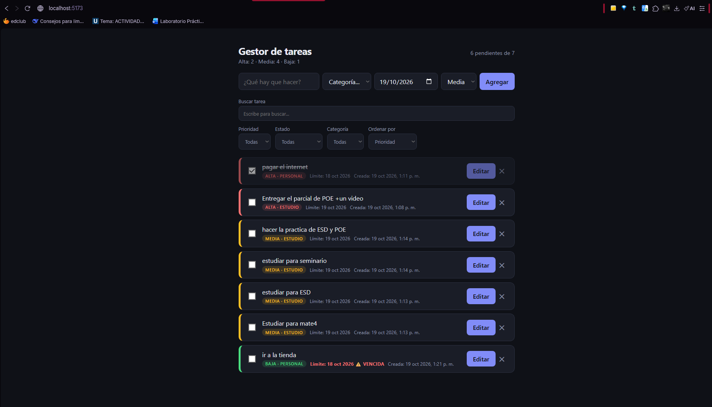
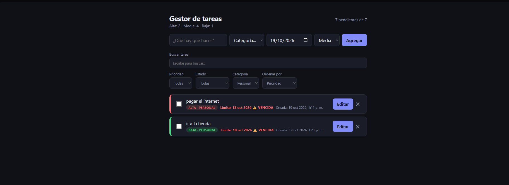

# Gestor de Tareas MVC - Parcial 2

Evaluación Parcial 2, Programación Orientada a Eventos.
Continuidad y actualización del proyecto base (Laboratorio #2).

Aplicación web desarrollada con TypeScript y Vite, sin frameworks. Implementa una arquitectura estricta **MVC (Modelo-Vista-Controlador)**, con separación de responsabilidades, tareas inmutables y persistencia en `localStorage`.

## Nuevas funcionalidades del Parcial 2

- **Campos extendidos:** cada tarea incluye categoría (`estudio`, `trabajo` o `personal`) y fecha límite.
- **Modo edición inmutable:** permite cargar una tarea en el formulario y actualizarla mediante una nueva instancia, sin modificar el objeto original.
- **Validación de títulos duplicados:** impide registrar o editar tareas con títulos iguales, ignorando mayúsculas y minúsculas.
- **Filtros combinados:** búsqueda por texto y filtros de prioridad, estado y categoría que se aplican simultáneamente.
- **Orden alfabético:** permite ordenar las tareas por título de A a Z.
- **Tareas vencidas:** las tareas pendientes cuya fecha límite ya pasó se muestran en rojo y con el aviso `⚠️ VENCIDA`.
- **Contadores por prioridad:** el encabezado muestra las cantidades de tareas de prioridad alta, media y baja.
- **Persistencia aislada:** el nuevo esquema utiliza la clave `lab2-poe:tareas:v2` para no mezclar datos anteriores.

## Capturas de pantalla




*Vista principal con el formulario, los filtros combinados y los contadores por prioridad.*



*Tarea vencida resaltada en rojo y mensaje de validación al intentar repetir un título.*

## Documento técnico y decisiones de diseño

| Decisión técnica | Justificación |
|---|---|
| Método unificado `TareaController.guardar` | Centraliza el flujo de alta y edición, incluida la validación de títulos duplicados. |
| Método `Tarea.editar` | Devuelve una copia nueva con los datos actualizados para conservar la inmutabilidad del modelo. |
| Uso de `.map()` al editar | Reemplaza solo la tarea modificada dentro de un arreglo nuevo, sin alterar el estado anterior. |
| Normalización del título | `trim()` y `toLocaleLowerCase()` permiten detectar duplicados aunque cambien espacios o mayúsculas. |
| Filtros encadenados en `obtenerVisibles` | La búsqueda, categoría, prioridad y estado se evalúan juntas para respetar todos los criterios seleccionados. |
| Clase `.vencida` | Fuerza la variable de prioridad al color rojo y agrega una alerta visible cuando una tarea pendiente está atrasada. |
| Type guard `esTareaDTO` | Verifica los datos recuperados desde `localStorage` antes de convertirlos en tareas del modelo. |
| Delegación de eventos | Los botones `Editar` y `Eliminar` usan un listener en la lista para evitar registrar listeners individuales en cada renderizado. |

## Arquitectura MVC

| Pieza | Responsabilidad |
|---|---|
| `Tarea` | Define la entidad, sus reglas de inmutabilidad y las conversiones DTO. |
| `TareaView` | Lee los eventos del DOM, muestra el formulario y renderiza las tareas. |
| `TareaController` | Coordina las reglas de negocio, edición, filtros, ordenamiento y persistencia. |
| `StorageService<T>` | Guarda y recupera listas genéricas desde `localStorage`. |
| `main.ts` | Ensambla las dependencias de la aplicación. |

El flujo general es: la vista detecta una acción del usuario, llama al controlador mediante un callback, el controlador actualiza el estado, el servicio persiste los datos y la vista vuelve a renderizar la información resultante.

## Requisitos e instalación

| Requisito | Detalle |
|---|---|
| Node.js | 20.19 o superior, o 22.12 o superior |
| npm | Incluido con Node.js |
| Navegador | Chrome, Edge, Firefox o Safari actualizado |

```powershell
git clone <url-del-repositorio>
cd LAB2_poe
npm install
npm run dev
```

Para validar la compilación:

```powershell
npm run build
```

## Dependencias

No hay dependencias de ejecución ni librerías externas. El proyecto utiliza únicamente:

- `typescript`: revisión de tipos y compilación.
- `vite`: servidor de desarrollo y empaquetado.

## Plan de pruebas manuales

- [ ] Registrar tareas con diferentes categorías, prioridades y fechas límite.
- [ ] Intentar registrar un título duplicado variando mayúsculas y comprobar que aparece un error.
- [ ] Editar una tarea, cambiar sus datos y confirmar que se actualiza sin duplicarse.
- [ ] Cancelar una edición y verificar que el formulario vuelve al modo `Agregar`.
- [ ] Escribir texto en el buscador y seleccionar una categoría; ambos filtros deben aplicarse al mismo tiempo.
- [ ] Ordenar por `Título (A-Z)` y verificar el orden alfabético.
- [ ] Crear una tarea con fecha anterior a hoy; debe mostrar `⚠️ VENCIDA` y el estilo rojo.
- [ ] Completar una tarea vencida; debe dejar de mostrarse como vencida.
- [ ] Marcar y desmarcar una tarea; el contador de pendientes debe actualizarse.
- [ ] Recargar la página y comprobar que las tareas se conservan mediante `localStorage`.
- [ ] Verificar en las herramientas del navegador la clave `lab2-poe:tareas:v2`.

## Estructura del proyecto

```text
LAB2_poe/
├── index.html
├── package.json
├── tsconfig.json
├── README.md
├── public/
│   ├── favicon.svg
│   ├── captura-principal.png
│   └── captura-vencidas.png
└── src/
    ├── main.ts
    ├── models/
    │   └── Tarea.ts
    ├── views/
    │   └── TareaView.ts
    ├── controllers/
    │   └── TareaController.ts
    ├── services/
    │   └── StorageService.ts
    └── styles/
        └── styles.css
```

## Autor

**Oscar Fabricio Guevara Aguilar**
Estudiante de Ingeniería en Desarrollo de Software.
Programación Orientada a Eventos.
